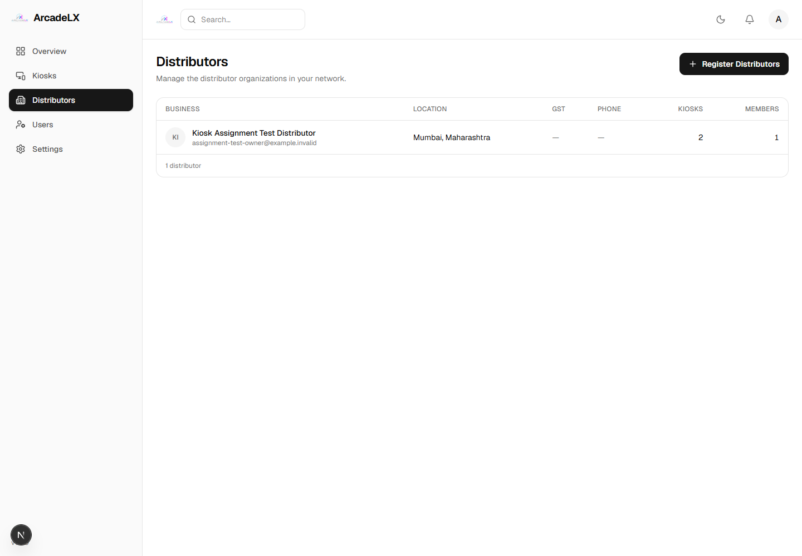
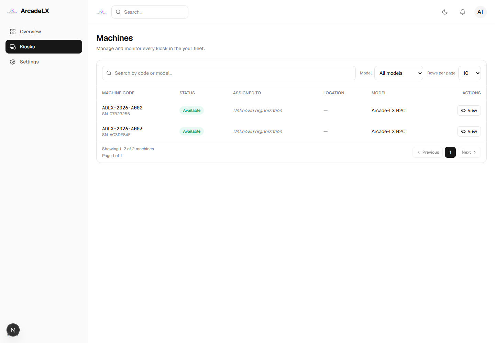

# Organization and kiosk assignment test

Created **Kiosk Assignment Test Distributor** through the frontend and transferred **2 kiosks** using the real API.

- Organization: `60668d89-f18d-41fc-b4af-603fbeee5782`
- Order: `ORD-2026-00001` / `43c54997-06ba-4d71-a8c7-aa565de223d3`
- State: DELIVERED; each kiosk is AVAILABLE and owned by the Distributor.
- Kiosks: `ADLX-2026-A002`, `ADLX-2026-A003`
- Extra kiosk `ADLX-2026-A001` stayed with the Company.
- Company Distributor list and Distributor kiosk inventory display the correct count.

The Kiosks screen currently has no assignment control. Assignment required the existing network, agreement, allocation, test payment, dispatch and delivery API flow. The Assigned To cells display ["Unknown organization","Unknown organization"] because the kiosk response supplies the organization ID without its name.

This test used a new isolated local database and captured email. The configured live database and existing inventory were not changed, and no real payment was made.

