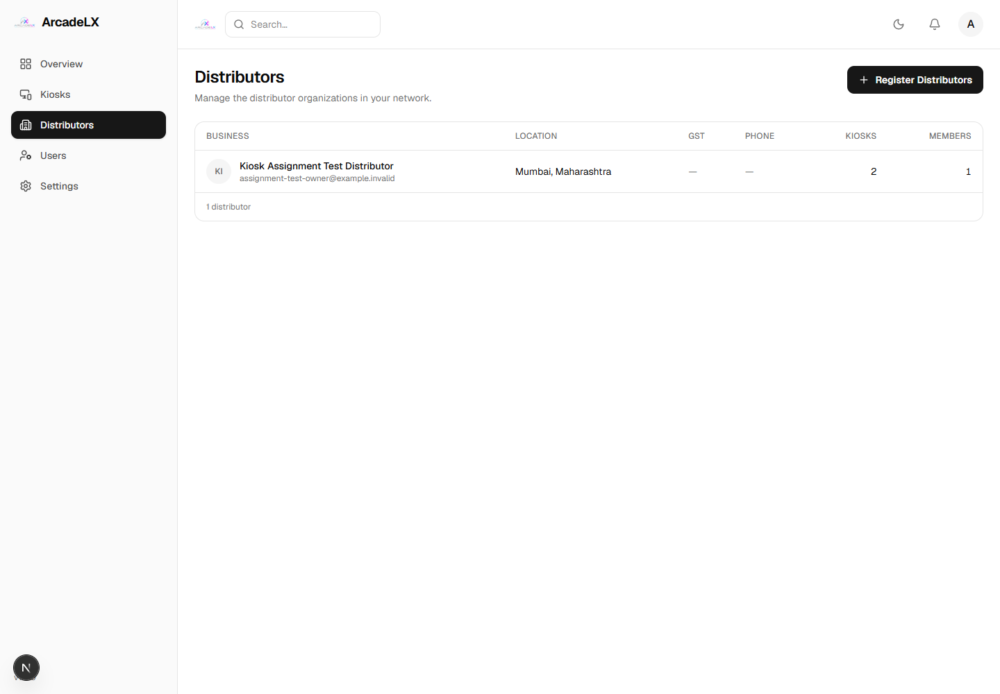
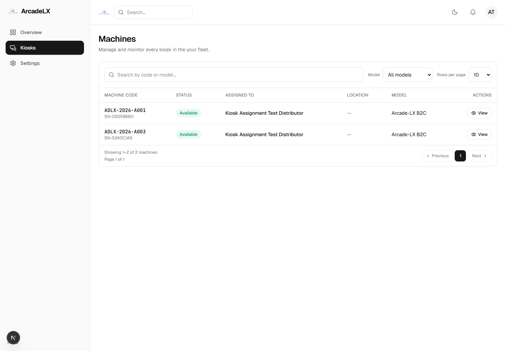

# Organization and kiosk assignment test

Created **Kiosk Assignment Test Distributor** through the frontend and transferred **2 kiosks** using the real API.

- Organization: `0615773f-b95e-4ead-b8c7-759ce09cea1f`
- Order: `ORD-2026-00001` / `35ed32f3-66ef-4976-a7a0-893489de4248`
- State: DELIVERED; each kiosk is AVAILABLE and owned by the Distributor.
- Kiosks: `ADLX-2026-A001`, `ADLX-2026-A003`
- Extra kiosk `ADLX-2026-A002` stayed with the Company.
- Company Distributor list and Distributor kiosk inventory display the correct count.

The Kiosks screen currently has no assignment control. Assignment required the existing network, agreement, allocation, test payment, dispatch and delivery API flow. The Assigned To cells display ["Kiosk Assignment Test Distributor","Kiosk Assignment Test Distributor"] and resolve the current Distributor name, while closed Company assignment history is retained. The Company view displays the same names and leaves the spare kiosk Unassigned.

This test used a new isolated local database and captured email. The configured live database and existing inventory were not changed, and no real payment was made.

