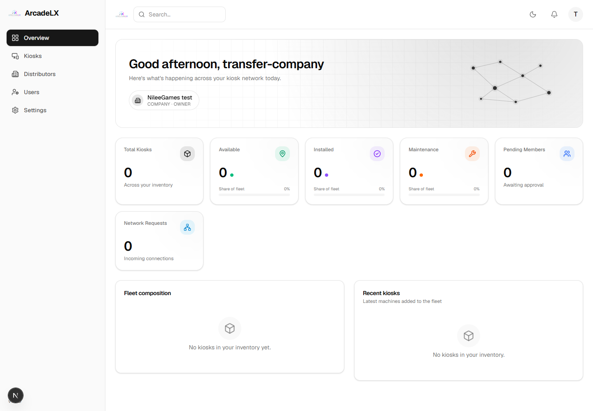
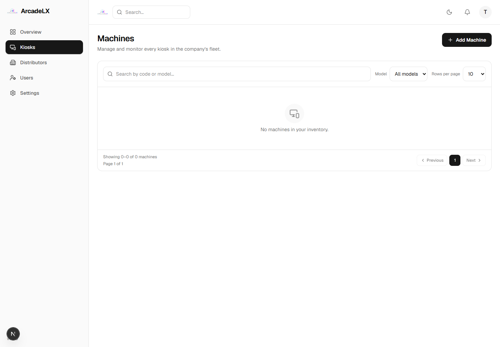
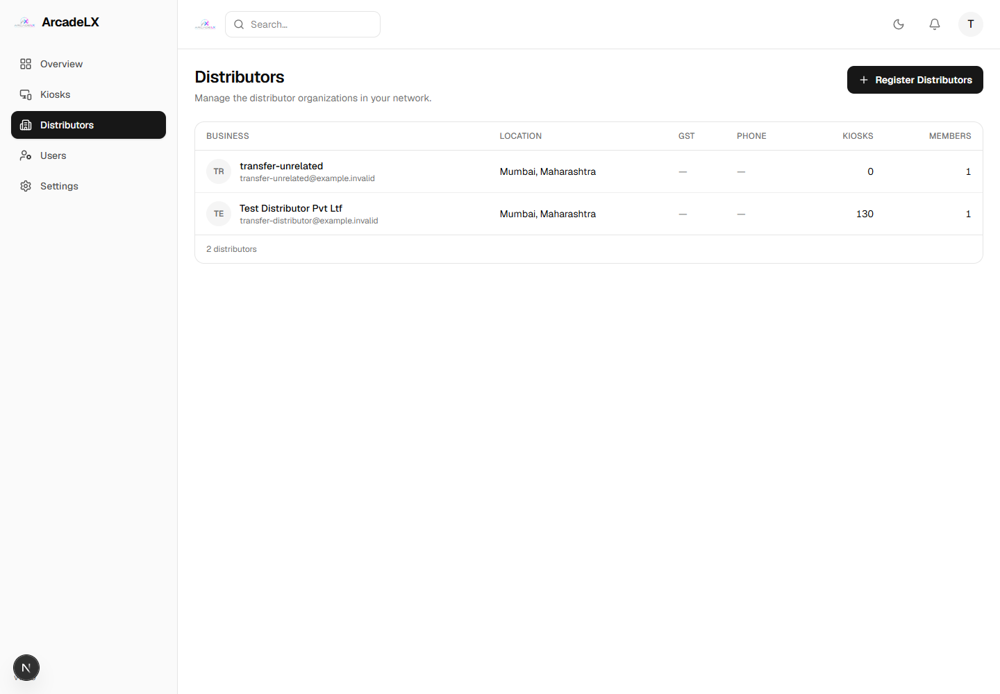
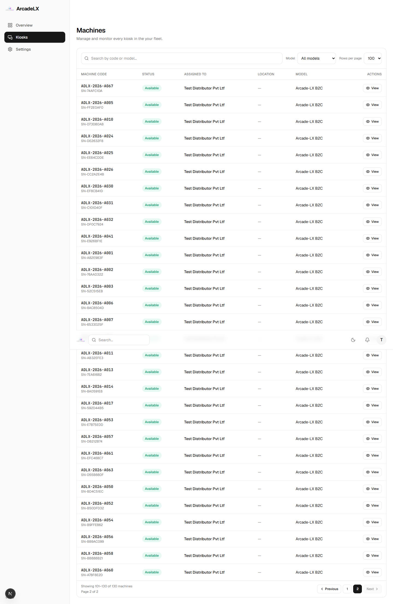

# Company to Distributor transfer verified

All **130 kiosks** transferred to **Test Distributor Pvt Ltf** through real HTTP handlers in a new, fully migrated local test database. Accounts and inventory were synthetic; names, quantity and agreement terms matched the running-app preflight. The existing running-app order was not copied or repaired.

| Stage | Company-owned | Distributor-owned |
| --- | ---: | ---: |
| Before | 130 | 0 |
| After all deliveries | 0 | 130 |

Orders used quantities **20, 50, 50, 10**. Reservation and dispatch kept each batch Company-owned; only delivery changed ownership. Every batch retained its exact linked kiosk quantity, and duplicate delivery was rejected. All 130 previous Company assignments were closed and retained; each kiosk has one open Distributor assignment.

Company inventory summary dropped to zero. The Company Kiosks screen and Recent kiosks dashboard became empty. The backend Company list still permits administrative visibility, while the frontend now selects current ownership. Partial-transfer checks also verified only the remaining 110 and then 10 Company-owned machines, model options and dashboard rows were visible. The Distributor inventory and Company Distributor-list count both showed 130. Every row was checked across two pages in each kiosk view.

Payment/delivery were simulated locally; no real payment or external email. The running database and its current 20-kiosk order were unchanged. Its missing lifecycle migration and inconsistent order remain deployment blockers.

[Machine-by-machine proof](transfer-proof.json) · [HTTP/database assertions](evidence.json)

