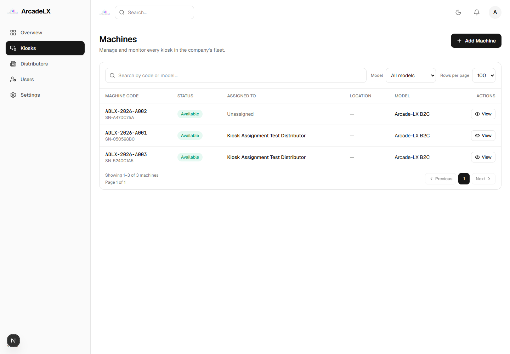

# Kiosk Assigned To: name resolution fixed

Verified 2026-09-29.

## Cause and change

The frontend already expects `currentOrg` and `assignedOrg`, but kiosk list and
detail responses supplied only `currentOrgId`. Assigned kiosks therefore rendered
as **Unknown organization**.

Both read endpoints now return organization display references containing only
`id`, `name` and `type`. Current ownership resolves through `currentOrg`; the
latest open assignment resolves through `assignedOrg`, or null when absent.
Closed assignment history is excluded from that display reference and retained
in the database. Existing ownership access checks and response envelopes remain.

This change only affects the kiosk controller's read projections. It does not
change frontend layout, kiosk mutations, Prisma schema or existing assignments.
Explicit projections also work with the running database's older schema.

## Running app versus test data

The running app uses the configured Supabase database. Its `/api/kiosks` returned
HTTP 200 with **130 kiosks, all Company-owned**. A real browser checked all 130
rows across pages: all correctly displayed **Unassigned**, with no Unknown
organization labels. Verification used GET requests and a temporary in-memory
access token; no database rows were written.

The earlier two-kiosk assignment was created in an isolated local test database,
so it is not an assignment in the running app. No test inventory was copied into
Supabase and the running database configuration was not switched.

## Regression verification

New isolated run: [20260929091925707/evidence.json](20260929091925707/evidence.json).
**34 HTTP requests, 19 assertions, zero mismatches.**

- Created **Kiosk Assignment Test Distributor** through the actual frontend form.
- Delivered exactly two kiosks through real network/agreement/order handlers.
- Both Company and Distributor kiosk views displayed the Distributor name.
- The extra Company kiosk displayed Unassigned.
- List and detail returned the expected names with only safe display fields.
- Closed Company assignment history remained stored and did not affect labels.
- Reading a kiosk belonging to another organization still returned 403.
- No browser errors; existing local database fingerprint unchanged.
- Backend and frontend TypeScript checks passed.
- Frontend lint passed: zero errors, 63 pre-existing warnings. Backend has no lint script.

Assignment identities and screenshots: [ASSIGNMENT.md](20260929091925707/ASSIGNMENT.md).



Repeat from the repository root:

```powershell
$env:AUDIT_PHASES='assign_organization'
$env:AUDIT_ASSIGN_QUANTITY='2'
npx.cmd tsx --tsconfig apps/api/tsconfig.json audits/distributor-lifecycle/harness/distributor-lifecycle.ts
```

`kiosk-assignment-diagnostic.ts` checks the running API and every rendered kiosk
row without mutations. It uses the temporary Playwright installation from this
session. An initial request timed out; the subsequent complete check passed.
