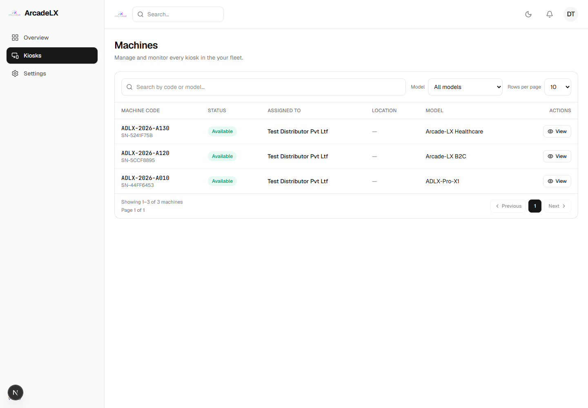
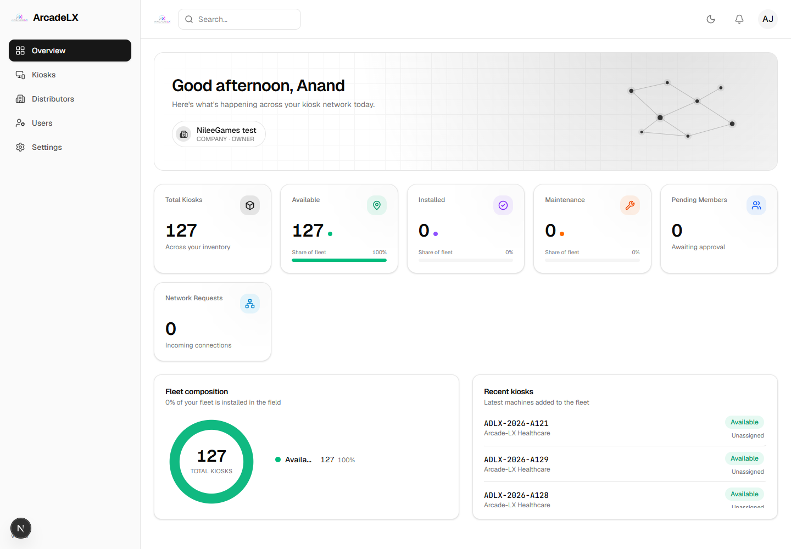

# Three model types assigned for the Distributor login test

Committed to the **configured running-app database** on 2026-09-29 at 10:01 UTC,
following the user's request to transfer some kiosks and test different models.

Recipient: **Test Distributor Pvt Ltf**, organization
`67abc491-0fec-4385-a8b9-ed95c4b94f08`.

| Machine | Model |
| --- | --- |
| ADLX-2026-A010 | ADLX-Pro-X1 |
| ADLX-2026-A120 | Arcade-LX B2C |
| ADLX-2026-A130 | Arcade-LX Healthcare |

This was a **direct test-data assignment**, not an execution of the paid-order
workflow. Three current-owner references were changed and three open assignment
records created, with `orderId = null`. No previous assignment rows existed for
these kiosks. Their status remains AVAILABLE; model, hardware and other details
were retained. Existing order/payment records and all other kiosks were unchanged.
No email was sent and no migration or application-code change was made.

The transaction rechecked active Company authority, exact Distributor identity,
active agreement/network, Company ownership, availability, absence of hardware
pairing and absence of active order links. It locked the relevant rows and would
roll back if any condition or affected-row count failed. Before/after records are
in [before.json](before.json) and [result.json](result.json).

## Verification

- Rehearsal: **11 HTTP requests, 6 assertions, zero mismatches** in a fresh local
  database. Unavailable stock rolled back, repeated assignment was rejected,
  history remained intact, and compatibility with the missing reservation column
  was tested locally. [Evidence](../20260929095936376/evidence.json).
- Running API/browser: **14 checks passed**, using the real Distributor login.
- Company inventory and dashboard: **127**; all three selected machines absent.
- Distributor inventory and dashboard: **3**, all labeled with the recipient name.
- The model dropdown contains all three models; each filter shows its one machine.
- [Verification record](verification.json).

The existing unpaid 20-kiosk order and undeployed lifecycle migration still need
separate reconciliation before using the commercial order/delivery workflow.

